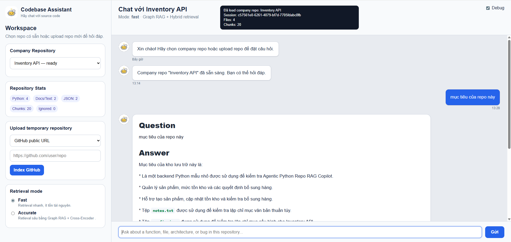
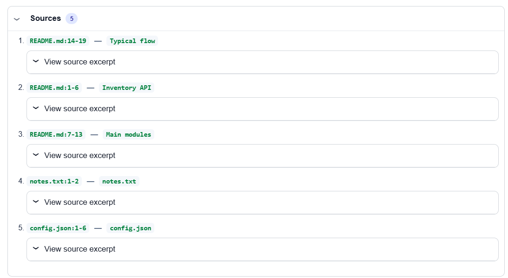
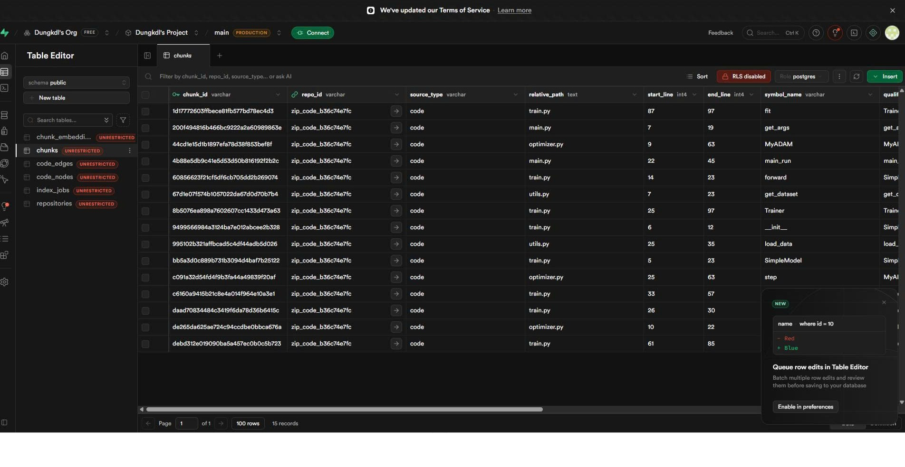
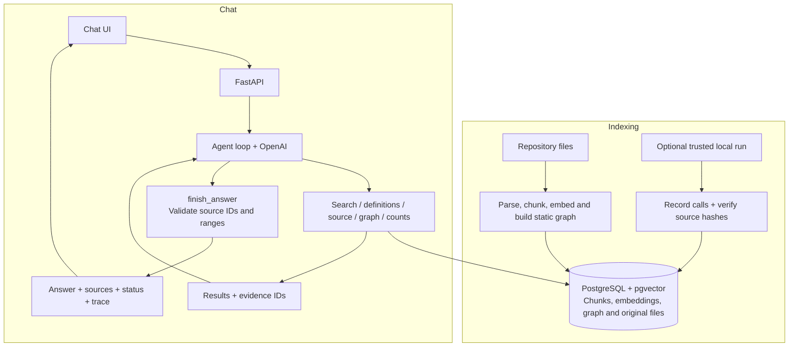
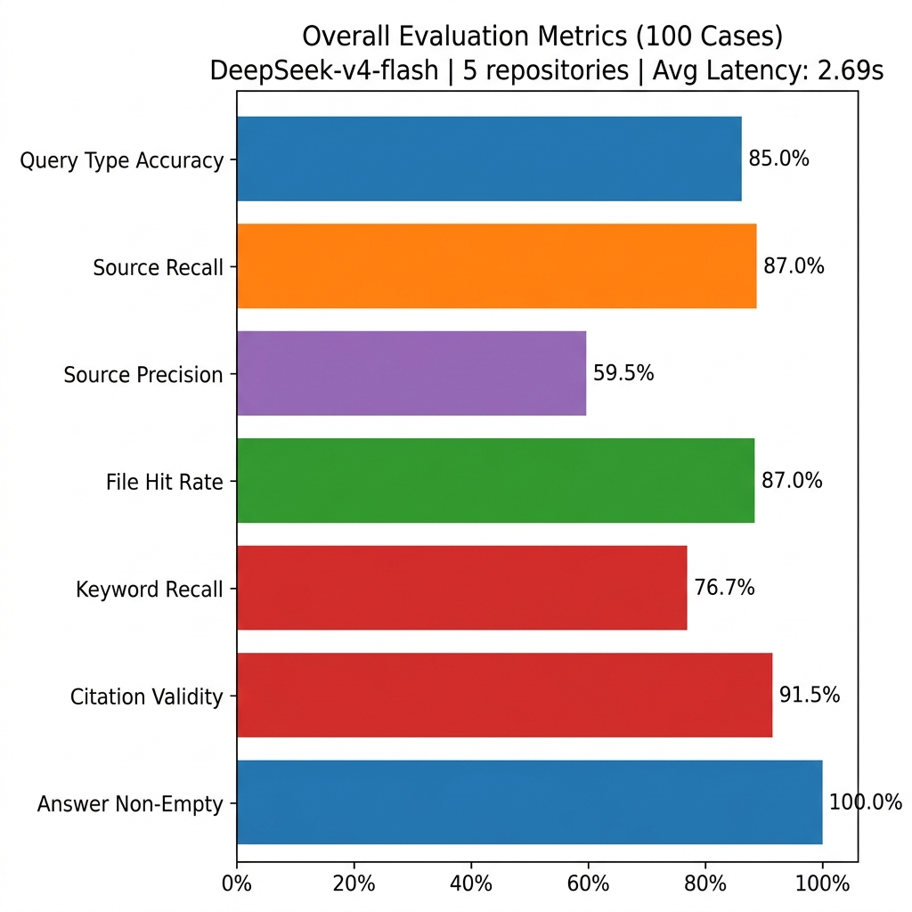

# Agentic Python Repo RAG Copilot

An AI agent for exploring Python repositories through questions and source citations. It combines hybrid retrieval, a bounded OpenAI tool loop, and a static call graph with optional runtime evidence to investigate code across files.

## Demo

| Chat interface | Sources and line ranges |
|:---:|:---:|
|  |  |

*Screenshots illustrate the interface from an earlier build; index counts and answers vary by version.*

<details>
<summary>Supabase storage preview</summary>



*Earlier database snapshot. The current schema also stores original indexed files in `repository_files` and graph evidence in `repository_graph_analysis`.*

</details>

## What it does

- **Investigates code:** finds definitions, reads source, finds references, and explores callers, callees, and potential impact with call-site evidence and unresolved-call reporting.
- **Separates static and runtime evidence:** optionally imports source-version-checked traces from trusted local runs; tools filter static candidates or observed calls.
- **Chooses its next action:** OpenAI observes tool results and continues until it submits an answer or reaches a run limit.
- **Combines retrieval methods:** vector search, BM25, and symbol matching with Reciprocal Rank Fusion (RRF); documentation queries add a documentation ranking.
- **Offers two retrieval modes:** Fast uses fused rankings; Accurate adds Cross-Encoder reranking.
- **Shows its evidence:** indexed file paths, line ranges, source excerpts, execution status, and tool traces.
- **Indexes multiple inputs:** persistent company repos, public GitHub repos, and ZIP uploads; supports Python, Markdown, JSON, and TXT.

Example questions: “Where is `create_task` implemented?”, “Who calls that method?”, and “Which code decides whether inventory needs restocking?”

### Why retrieval and a graph?

Text search is useful when the identifier is known. BM25 ranks keyword matches; vector search helps with conceptual queries; the graph follows structural relationships. The agent combines these tools and reads the relevant source before answering. Comparative evaluation is needed to measure the contribution of each component.

## How it works



Source repositories are read during indexing. Chat uses indexed PostgreSQL data without reading the original repository from disk. Re-index after source changes.

| Component | Implementation |
|---|---|
| API and UI | FastAPI, static HTML/CSS/JS; optional Streamlit debug UI |
| LLM | OpenAI Responses API, GPT-6 Luna (`gpt-6-luna`) |
| Storage | Supabase/PostgreSQL, pgvector, SQLAlchemy |
| Retrieval | `all-MiniLM-L6-v2` (384 dimensions), rank-bm25, symbol/documentation search, RRF |
| Reranking | `cross-encoder/ms-marco-MiniLM-L-6-v2` |
| Code graph | Scoped AST call candidates, call-site evidence, optional runtime observations |

## Quick start

Already have the local environment and indexed samples? Follow [the two-terminal local startup](./docs/running.md#existing-local-environment). Keep both servers running while using http://localhost:5173; an API key alone does not start them.

For a fresh Docker setup, the steps below require Docker Compose, PostgreSQL with pgvector support, and an OpenAI API key with access to the configured model. The Docker image uses Python 3.10.

**1. Configure the backend** from the repository root:

```sh
cd backend
cp .env.example .env
```

Edit `backend/.env` using [the template](./backend/.env.example):

| Setting | Value |
|---|---|
| `DATABASE_URL` | PostgreSQL connection URI; use SSL for Supabase and URL-encode password characters |
| `OPENAI_API_KEY` | Your OpenAI API key |
| `LLM_BACKEND` | `openai` |
| `OPENAI_MODEL` | `gpt-6-luna` (the project's selected model) |
| `OPENAI_REASONING_EFFORT` / `AGENT_MODE` | `low` / `loop` |

The backend uses PostgreSQL directly; Supabase REST credentials are not required for this path. Keep credentials out of source control.

**2. Build, initialize tables, index the samples, and start the API** from the same terminal:

```sh
docker compose build api
docker compose run --rm api python -m scripts.init_db
docker compose run --rm api python -m scripts.index_company_repo taskflow_api
docker compose run --rm api python -m scripts.index_company_repo inventory_api
docker compose --profile app up api
```

Indexing replaces the selected repo's previous index. The first model load downloads embedding weights.

**3. Serve the frontend** in a second terminal, from the repository root:

```sh
cd frontend
python -m http.server 5173
```

Open **http://localhost:5173**, select a repo, and ask a question. API documentation is at **http://localhost:8000/docs**. Serve the frontend over HTTP; opening the HTML file directly is not the supported setup.

For an existing local environment, VS Code tasks, Streamlit, local PostgreSQL, deployment, and shutdown commands, see [running and deployment](./docs/running.md).

## Evaluation and baseline

**Validation on 2026-11-14:** 76 offline tests passed, including static-call resolution, runtime evidence and target-package isolation. Live checks on both samples covered six API questions, follow-up/repo-switch history, source ranges, imported runtime traces and an additional browser-rendered answer. These are functional smoke checks, not a full benchmark.

**Historical reference baseline:** the earlier DeepSeek workflow reported 100 cases across five repositories:

| Metric | Historical result |
|---|---:|
| Query type accuracy | 85.00% |
| Average source recall | 87.00% |
| Average source precision | 59.52% |
| Average citation validity | 91.52% |
| Average latency | 2.69 s |

These are archived figures, **not results for the current OpenAI agent**. Three historical repo fixtures are absent, some expectations need updating, and archived model labels disagree; see [evaluation details](./docs/evaluation.md).

<details>
<summary>Historical benchmark chart</summary>



</details>

Run offline tests from `backend/` with the project environment:

```sh
python -m unittest discover -s tests -v
```

The runner supports `--agent-mode workflow` versus `--agent-mode loop` with the same configured model. [Evaluation details](./docs/evaluation.md) cover commands, fixture requirements, metric definitions, and the remaining comparison work. No BM25-only or graph ablation results are claimed.

## Scope and limitations

- This is a **read-only code investigation agent**. Chat/indexing do not edit or execute repository programs; the separate runtime recording CLI executes only the trusted program you explicitly select.
- Structural analysis targets Python. Static flow and impact describe possible relationships; optional runtime traces cover recorded runs only. Neither proves that an edit causes a failure.
- Source validation checks paths and line ranges, not the correctness of every statement in an answer.
- Sessions and bounded conversation history are in memory; API restarts clear them.
- Defaults limit each question to 8 model turns, 16 tool calls, 90 seconds, and bounded context. Accurate mode adds model loading and reranking overhead.
- Large repositories have not been benchmarked. Indexing holds source/chunks/embeddings in memory and waits within the HTTP request; background jobs, progress reporting and incremental indexing are not implemented. See [indexing limits](./docs/running.md#indexing-limits).
- Multi-user production hardening remains future work.

## Further reading

- [Agent design, tools, limits, and upgrade guide](./docs/agent-upgrade.md)
- [Static call graph, runtime evidence, and graph upgrade commands](./docs/call-graph.md)
- [Evaluation, historical charts, and baseline comparison](./docs/evaluation.md)
- [Running locally, Docker options, and deployment](./docs/running.md)
- [Publish these changes to GitHub](./docs/github.md)
- [Environment template](./backend/.env.example) · [Sample repositories](./company_repos)
