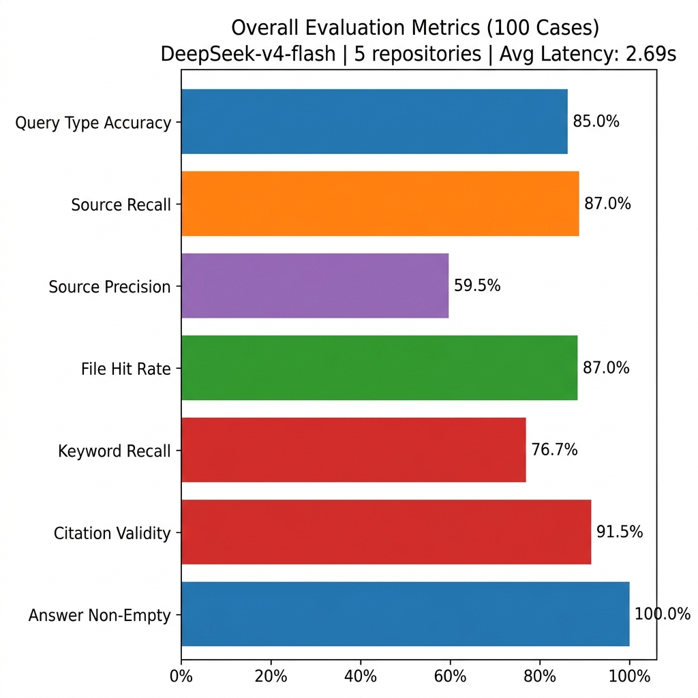
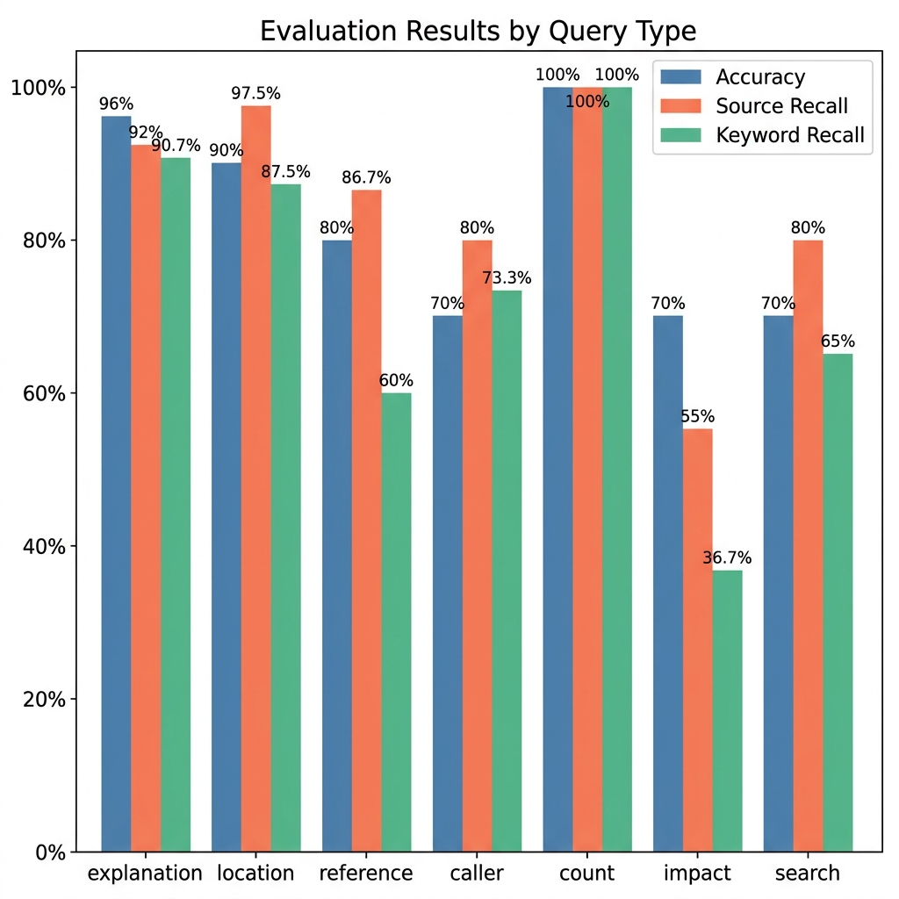
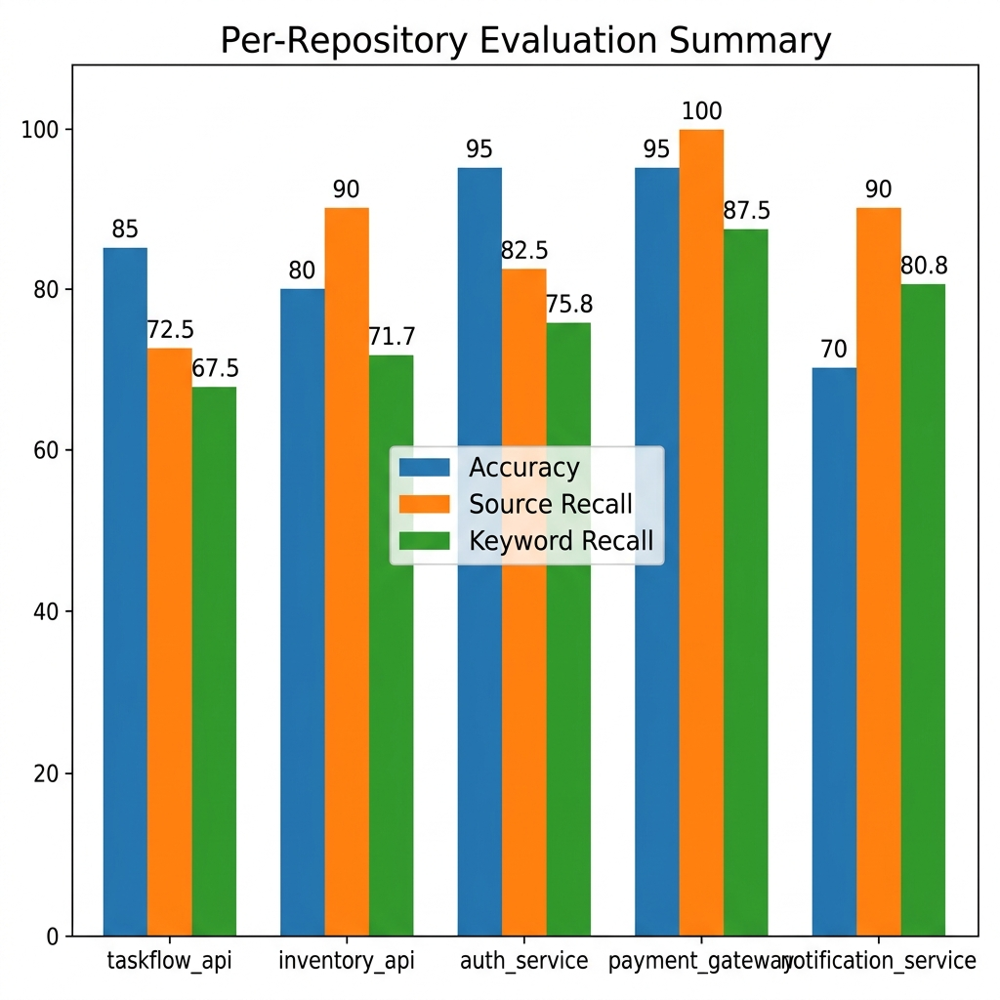
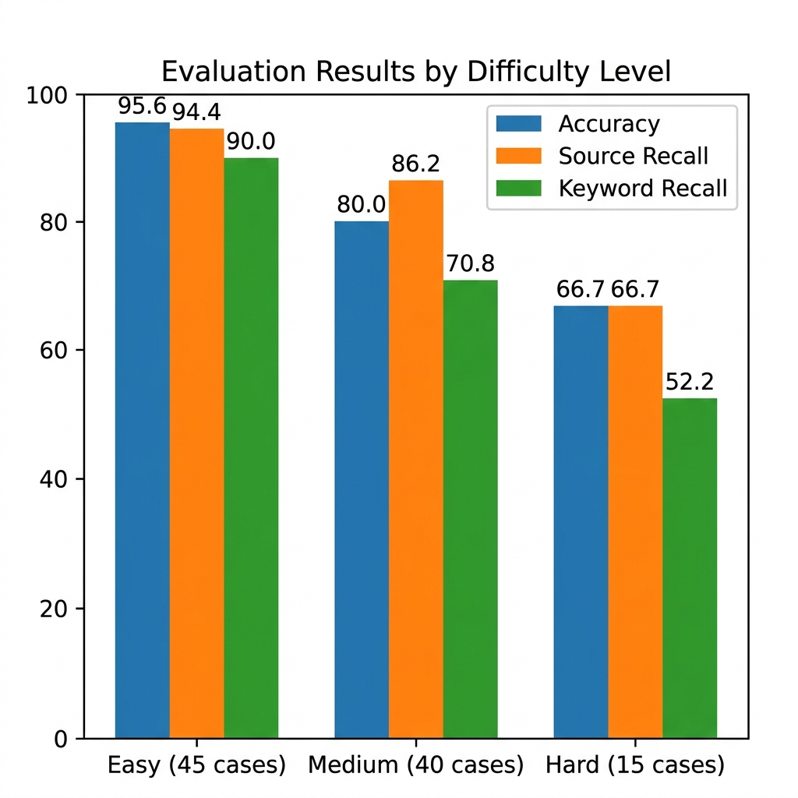

# Evaluation and baselines

[Back to README](../README.md)

## Current validation

The latest local validation passed **46 offline tests** covering agent loop decisions, error and budget handling, OpenAI Responses serialization through mocked HTTP, API/session behavior, and source snapshot persistence.

Live smoke checks used `gpt-6-luna`, Fast retrieval, Supabase, and the two bundled fixtures:

| Check | Observed behavior |
|---|---|
| Explain `TaskService.create_task` | Found the definition, read source, and completed with source citations |
| Follow up: where is that method called? | Used conversation context, found callers, read the calling file, and cited it |
| Find how inventory replenishment is decided | Used hybrid search and read the service/model implementation |

These are functional checks, not a representative estimate of answer accuracy or latency.

Run offline tests from `backend/` with the installed project dependencies:

```sh
python -m unittest discover -s tests -v
```

Tests do not require an API key, downloaded embedding weights, or an external database.

## Comparing the workflow baseline with the agent

[The runner](../backend/scripts/run_eval.py) supports the fixed workflow and the tool loop with the same configured OpenAI model. From `backend/`:

```sh
python -m scripts.run_eval --repo taskflow_api --repo inventory_api --agent-mode workflow
python -m scripts.run_eval --repo taskflow_api --repo inventory_api --agent-mode loop
```

Both commands call OpenAI and write/reset evaluation vector collections in the configured database. They print per-case and summary results. A controlled current comparison has **not** been completed.

Before comparing:

1. Review [the cases](../backend/data/eval_cases.json) against the exact fixture version. Some historical paths and symbols no longer match.
2. Supply missing fixtures for a 100-case run, or explicitly select the available repos. `--skip-missing-repos` skips absent fixtures; report the resulting case count.
3. Keep the model, reasoning effort, retrieval mode, repo contents, and questions identical across runs.
4. Save the configuration and per-case outputs. Report source quality, answer correctness, abstention, completion, latency, tool/model calls, and token usage separately.

The bundled fixtures are [TaskFlow](../company_repos/taskflow_api) and [Inventory](../company_repos/inventory_api). Historical fixtures `auth_service`, `payment_gateway`, and `notification_service` are absent.

### What the current controls can establish

| Comparison | Status |
|---|---|
| Fixed workflow vs adaptive tool loop, same model | Supported by `--agent-mode`; controlled results pending |
| BM25-only vs vector-only vs hybrid retrieval | Additional experiment configuration and measurements needed |
| Graph enabled vs graph disabled | Additional experiment configuration and measurements needed |
| Human text search vs agent-assisted investigation | Requires a timed task study; no measurements recorded |

The archived DeepSeek run also differs in model and implementation, so it cannot isolate the effect of the new loop, BM25, or graph traversal.

## Metric interpretation

Definitions live in [metrics](../backend/src/evaluation/metrics.py) and [the evaluator](../backend/src/evaluation/eval_runner.py).

| Metric | Interpretation |
|---|---|
| Query type accuracy | Fraction with the expected query label; not answer accuracy. In loop mode the label comes from fallback rules, while the model chooses tools independently. |
| Source recall | Expected citations matched / expected citations; ranged matches require coverage of the expected range |
| Source precision | Returned citations matching an expected citation / returned citations |
| File hit rate | Fraction of expected files represented in the returned sources |
| Keyword recall | Fraction of expected keywords present in the answer; a content proxy, not semantic correctness |
| Citation validity | Paths exist and line ranges fit inside files; does not establish support for the answer's claims |
| Agent completion | Fraction with status `completed`; execution success is separate from answer correctness |
| Latency and usage | Time, tool/model calls, and reported tokens per question |

Empty-source cases affect aggregates: recall defaults to 100% when no sources are expected, precision to 0% when none are returned, and citation validity to 100% when no citations exist. Report count-only and source-bearing questions separately when interpreting these values. Abstention and forbidden-keyword checks are heuristic.

## Historical DeepSeek reference

The following tables and charts are preserved from the earlier README. That report described **100 cases, five repositories, seven query types, Fast retrieval, and an enabled LLM router**.

**Provenance limitation:** the earlier text identified `deepseek-chat`, while the overall chart labels the model `DeepSeek-v4-flash`. Raw per-case run outputs and an exact run configuration are not included in this checkout, so the historical model identity and reported aggregates cannot be independently reconstructed here. These figures are archived reference material, not verified current OpenAI performance.

In the tables below, “accuracy” means **query type classification accuracy**.

## Overall Metrics

| Metric | Score |
|---|---|
| **Query Type Accuracy** | 85.00% |
| **Avg Source Recall** | 87.00% |
| **Expected Sources All Found Rate** | 84.00% |
| **Avg Source Precision** | 59.52% |
| **Avg File Hit Rate** | 87.00% |
| **Answer Non-Empty Rate** | 100.00% |
| **Avg Keyword Recall** | 76.67% |
| **Avg Citation Validity** | 91.52% |
| **Avg Latency** | 2.69s |
| **Router Fallback Rate** | 3.00% |
| **LLM Failure Rate** | 0.00% |
| **Abstention Accuracy** | 100.00% |
| **Forbidden Keyword Hit Rate** | 0.00% |



## Results by Query Type

| Query Type | Cases | Accuracy | Avg Source Recall | Avg Keyword Recall | Avg Latency |
|---|---|---|---|---|---|
| `explanation_query` | 25 | 96.0% | 92.0% | 90.7% | 2.71s |
| `location_query` | 20 | 90.0% | 97.5% | 87.5% | 2.08s |
| `reference_query` | 15 | 80.0% | 86.7% | 60.0% | 2.54s |
| `caller_query` | 10 | 70.0% | 80.0% | 73.3% | 3.29s |
| `count_query` | 10 | 100.0% | 100.0% | 100.0% | 1.43s |
| `impact_query` | 10 | 70.0% | 55.0% | 36.7% | 4.12s |
| `search_query` | 10 | 70.0% | 80.0% | 65.0% | 3.29s |



## Per-Repository Summary

| Repository | Cases | Query Type Acc | Avg Source Recall | Avg Precision | Avg Keyword Recall | Avg Latency |
|---|---|---|---|---|---|---|
| `taskflow_api` | 20 | 85.0% | 72.5% | 46.3% | 67.5% | 2.54s |
| `inventory_api` | 20 | 80.0% | 90.0% | 55.9% | 71.7% | 2.77s |
| `auth_service` | 20 | 95.0% | 82.5% | 65.1% | 75.8% | 2.67s |
| `payment_gateway` | 20 | 95.0% | 100.0% | 65.7% | 87.5% | 2.71s |
| `notification_service` | 20 | 70.0% | 90.0% | 64.5% | 80.8% | 2.74s |



## Results by Difficulty

| Difficulty | Cases | Accuracy | Avg Source Recall | Avg Keyword Recall | Avg Latency |
|---|---|---|---|---|---|
| `easy` | 45 | 95.6% | 94.4% | 90.0% | 2.20s |
| `medium` | 40 | 80.0% | 86.2% | 70.8% | 2.91s |
| `hard` | 15 | 66.7% | 66.7% | 52.2% | 3.56s |



These aggregates do not demonstrate that BM25 or graph retrieval outperforms text search. That claim needs the controlled comparisons described above.
